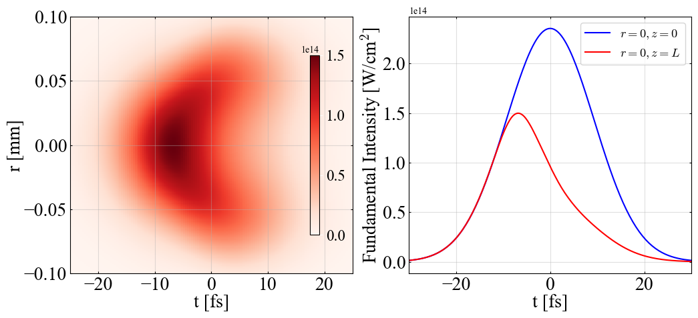
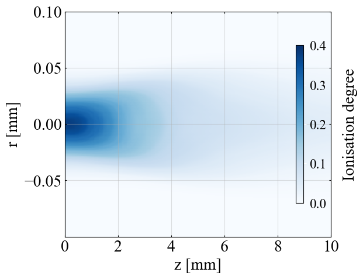
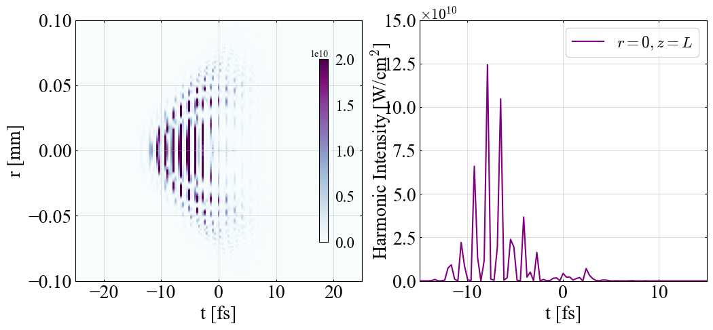
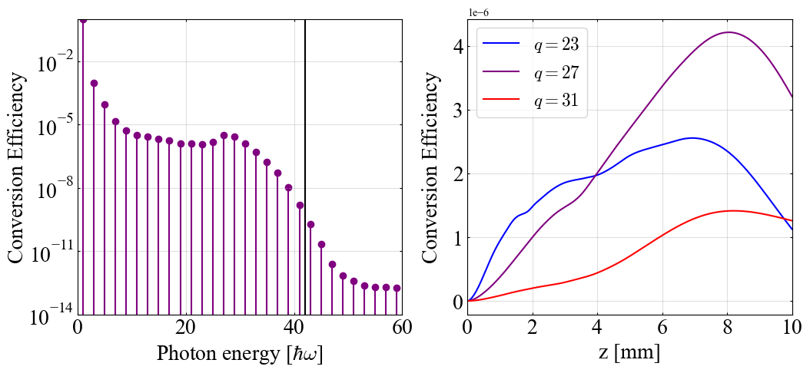

Post-Process
------------

Here is a typical example of a post-processing analysis, illustrating how to work with the different output files and highlighting some physical properties. 
The following analysis and results refer to the input file provided in the HarP folder.

Before proceeding with the post-processing, make sure that the simulation has finished. (If you have not yet run a simulation, refer to the :doc:`First simulation <installation>` section.)

Once the diagnostics are stored in **HDF5** files, a first analysis can be performed using the Jupyter notebook ``analysis.ipynb`` provided in the HarP repository.

Copy the notebook into your working directory:

.. code-block:: bash

    cp path/to/HarP/analysis.ipynb .

When running the notebook make sure to use the environment generated by ``make dev`` command. 

The first notebook cell defines the physical constants and necessary libraries.

----

Load HDF5 files
^^^^^^^^^^^^^^^

The second cell loads the **HDF5** files diagnostics into NumPy arrays named as follows:

    * ``REq``: the electric field envelope :math:`\mathcal{E}_q` at :math:`z=Lz`,
    * ``ceq``: the energy contained in each harmonic,
    * ``Ne``: the electronic density,
    * ``Na``: the atomic density,

The logic behind this procedure applies to each of the diagnostics available in the :doc:`namelist <namelist>` and can be understood from the **HDF5** file structure.

The **HDF5** files associated with the diagnostic class ``Diagnostic`` are organised as follows. 
The coordinates ``"r"``, ``"z"`` and ``"t"`` are stored as first-level datasets and correspond to the radial, axial and temporal grids over which the data have been saved.

In the case of a quantity that depends on the harmonic order (such as :math:`\mathcal{E}_q`), the data are organized under the first-level groups named ``"order_XX"`` where ``XX`` denotes the harmonic order.
Within each group, the quantity is stored as a series of second-level datasets named ``"t_j"`` with :math:`j` corresponding to the different time steps. 
Each dataset contains a two-dimensional array representing the quantity over the radial and longitudinal grid positions.

For quantities that are independent of the harmonic order, such as the particle densities, the datasets ``"t_j"`` are stored directly at the first-level.

----

Fundamental field intensity
^^^^^^^^^^^^^^^^^^^^^^^^^^^

The third cell visualizes the intensity of the fundamental envelope field. It produces :numref:`figFundamental`.

.. _figFundamental:

   
   Fundamental intensity as a function of :math:`t` and :math:`r` at :math:`z=L` (left) and as a function of :math:`t` at :math:`r=0` for :math:`z=0` and :math:`z=L` (right).

The left panel shows the intensity as a function of :math:`r` and :math:`t` at the end of the simulation box :math:`z=L`. 
The right panel shows the same quantity along the propagation axis :math:`r=0`. It shows the field at the beginning of the gas, :math:`z=0` (blue), compared with that at the end of the gas, :math:`z=L` (red). 
This figure illustrates how the fundamental field evolves as it propagates and ionises the gas, causing it to deviate from its initial Gaussian nature.

----

Electronic density
^^^^^^^^^^^^^^^^^^

To show the effect of the ionisation, the fourth cell illustrates the electron density at the end of the interaction as a function of :math:`r` and :math:`z`. The cell produces :numref:`figIonisation`.
As the field has not been modified yet at enter of the gas cell, it reaches higher intensity. Thus, it leads to higher ionisation degree, equivalently electron density.
Inversely, after longer propagation into the gas cell the field has been dispersed by the electronic density, and is less likely to ionise.

.. _figIonisation:

   Ionisation degree at the end of the interaction as a function of :math:`r` and :math:`z`.

----

Attosecond field intensity
^^^^^^^^^^^^^^^^^^^^^^^^^^

In the HarP approach, the harmonics envelopes are computed only at specific photons energy :math:`q\hbar \omega`.
The real electric field :math:`\mathcal{E}(t)` is defined as:

.. math::

    \mathcal{E}(t) = \frac{1}{2}\sum_{q} E_q(t) e^{-\mathbf{i} q \omega t}+c.c.

Assuming that we filter only the photons of energy in between :math:`[q_1\hbar \omega ,q_2 \hbar \omega]`, the reconstructed harmonic field is estimated as:

.. math::
    :label: Etimefield

    \mathcal{E}(t) = \frac{1}{2}\sum_{q\in [q_1,q_2]} E_q(t) e^{-\mathbf{i} q \omega t}+c.c.

The vector ``REt``, defined in the second cell, corresponds to the time-electric field Eq. :eq:`Etimefield` at :math:`z=L`. It is calculated for all the different potential lower threshold :math:`q_1 \in [1,59]` (odd) with :math:`q_2=59` the last computed harmonic.
The instantaneous time-intensity :math:`I(t)` being :math:`I(t)=\epsilon_0 c \lvert \mathcal{E}(t)\rvert^2`.
Considering a high pass filter with :math:`q_1=23` (equivalently photon of energy larger than :math:`\sim 35` eV), we obtain the harmonic intensity :numref:`figHarmonicIntensity` (fifth cell) as a function of :math:`r` and :math:`t` in the left plot and as a function of :math:`t` at :math:`r=0` in the right one.

.. _figHarmonicIntensity:

   Harmonic intensity :math:`\epsilon_0 c/2 \lvert \mathcal{E}(t)\rvert^2` considering :math:`q_1=23,q_2=59` as a function of :math:`r` and :math:`t` (left) and as a function of :math:`t` at :math:`r=0` (right) at the exit of the target (:math:`z=L`).

Reconstructing the oscillating field itself via Eq. :eq:`Etimefield` requires resolving the fast carrier :math:`e^{-iq\omega t}` — an attosecond-scale time grid, much finer than what HarP's own propagation needs (which only solves for the slowly varying envelopes :math:`E_q(t)`).
The time grid used in this example simulation is too coarse for that: the reconstructed time-electric field in :numref:`figHarmonicIntensity` appears undersampled.
This is a limitation of this particular post-processing step only, not of HarP's propagation algorithm itself.

----

Conversion efficiency
^^^^^^^^^^^^^^^^^^^^^

A specific diagnostic that computes the energy inside each harmonic has been implemented in the input file. 
The conversion efficiency, ratio between the harmonic energy and the fundamental one, is shown in :numref:`figCE`, (computed in the sixth cell) as a function of the harmonic order at :math:`z=L` (left) and as a function of the propagation distance for :math:`q=23,27,31` (right).

.. _figCE:

   Conversion efficiency at the end of the target as a function of the photon energy (left) and as a function of the propagation distance for the 23rd, 27th and 31st harmonics (right). The black solid line (left) stands for the three-step cutoff energy.

The cutoff energy predicted by the three step model [Corkum1993]_, [Kulander1993]_ is shown in black solid line of the left panel. It reads:

.. math::

    \text{E}_{\rm{cutoff}} = I_p +3.17 \frac{e^2 \lvert E_0 \rvert^2 }{4 m_e \omega^2} \sim \left[I_p\right] + 29.6 \left[\frac{I_0}{10^{14} \rm{W/cm}^2}\right]\left[\frac{\lambda}{1 \mu\rm{m}}\right]^2 \rm{eV}.

In Argon the ionisation energy is :math:`I_p\sim 15.8` eV. With the laser of wavelength :math:`\lambda=0.81 \, \mu` m and peak intensity :math:`I_0=2.5\times 10^{14}` W/cm :sup:`2`, the cutoff energy is estimated as :math:`\text{E}_{\rm{cutoff}}\sim 42 \hbar \omega \sim 64` eV.

The variation of the CE with the propagation distance arises from the competition among harmonic generation, propagation, and absorption. 
As finding the optimal target configuration is an active subject of research that mainly requires maximising the CE, HarP is designed to enable its efficient evaluation and optimization.
