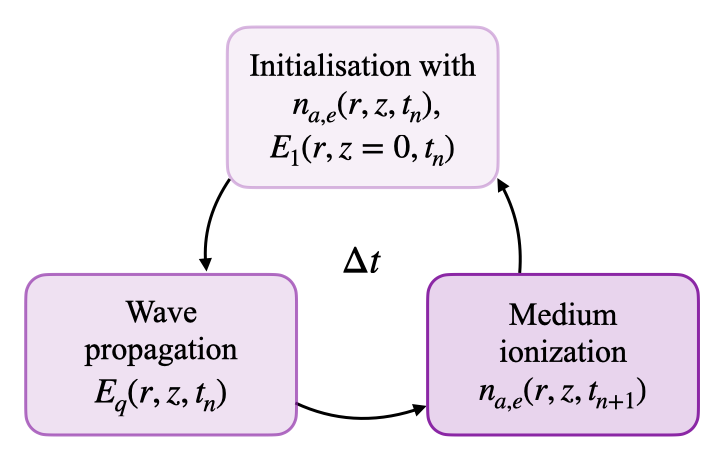

HarP Algorithm
--------------

The :program:`HarP` algorithm was first introduced in [LHuillier1992]_ and was one of the earliest numerical approaches capable of reproducing the main trends of the harmonics generated in a gas. 
Since then, this method has been applied to different geometries to optimise and analyse experiments [Antoine1996]_, [Weissenbilder2022]_, [Westerberg2025]_, [Vardast2026]_.

----

HarP Loop
^^^^^^^^^

As discussed during the :doc:`derivation of the equations <harp_equations>`, the problem is separated into two distinct time scales: the rapid oscillation of the optical field and the slowly varying pulse envelope.
The oscillations are treated in the frequency domain, whereas the evolution of the slowly varying envelope is solved in the time domain.

The space-time domain is uniformly discretised into :math:`N_t \times N_r \times N_z` grid points with time and spatial steps :math:`\Delta t`, :math:`\Delta r`, and :math:`\Delta z`, respectively. 
The loop consists of performing the following operations at each time step :math:`t_n` :

    #. The fundamental field is initialized at the boundary with the prescribed pulse envelope, :math:`E_1(r, z=0, t_n)`.
    #. The propagation equations are solved for the fundamental :math:`E_1(r, z, t_n)` and harmonic field envelopes :math:`E_q(r, z, t_n)` over the :math:`(r, z)` domain.
    #. The atomic and electronic densities are updated following the population equations. The ionisation rate is evaluated from the fundamental field :math:`E_1(r, z, t_n)`.
    #. The wave vectors and the propagation equations are modified considering the updated medium densities.

.. _HarP_loop:

  
  Schematic representation of the HarP loop. At each time slice, the propagation equation is resolved using the Crank-Nicolson scheme. Densities are calculated from the driver field and used in the definition of the propagation equation at the next time step.

A schematisation is provided in :numref:`HarP_loop` and can be understood as follows: as the driving field propagates through the gas, it ionises the medium, thereby altering its own propagation. 
For each time slice resolving the evolution of the field envelope, the spatial propagation is computed over the entire domain. 
The resulting field distribution is then used to update the densities, which dictate the propagation parameters for the subsequent time iteration.

To efficiently deal with the three-dimensional variables, the harmonic field envelopes are stored in a vector of dimension :math:`q \times N_r`, containing the radial distribution of each harmonic at a specific longitudinal and time position.
Additional diagnostics are implemented to save the quantities at user-defined positions.
Similarly, the atomic and electronic densities are stored as arrays of size :math:`N_r` and saved at user-selected time/longitudinal steps.

----

Crank-Nicolson Scheme
^^^^^^^^^^^^^^^^^^^^^

The propagation equation of the qth harmonic, which is given by:

.. math::

    \partial_r^2 E_q + \frac{1}{r}\partial_r E_q+ 2ik_{q,0}(z)\partial_z E_q +2k_{q,0} [\delta k_q(r,z)+ \Delta k_{q,0}(z)]E_q= -4 q^2 \rho_a(r,z)d_q(r,z)e^{\mathbf{i}q\phi_1(r,z)}

is solved at each time step, using a Crank-Nicolson scheme. This scheme is expressed through the following matrix relation:

.. math::

    M^{n+1}(\alpha)E^{n+1} = M^{n}(-\alpha)E^{n} + S^{n},

where the vector :math:`E^{n}=(E_0^n,E_1^n,...,E_{N_r-1}^n)` stores the value of the electric field envelope of all radial positions :math:`r_j` at :math:`z=z_n`. 

Although the harmonic-order dependency (:math:`q`) is omitted in the above notation for clarity, the matrix equation is solved independently for every individual harmonic and the fundamental driver field. 
Each possesses its own spatially discretized envelope vector :math:`E_q` and wavevector :math:`k_q`. 

Matrix
""""""

The tridiagonal matrix :math:`M^n` composed of coefficients :math:`m_{i,j}^n(\alpha)` (with :math:`\alpha=\mathbf{i}\Delta z/(4 \Delta r ^2)`) related to the wavevector 
denoted :math:`k^{0,n}=k_{q,0}(z_n)`, :math:`\Delta k^{0,n}=\Delta k_{q,0}(z_n)` (independent of the transverse coordinate by definition) 
and :math:`\delta k^{n}_j = \delta k_q(r_j,z_n)`. 

For internal nodes (:math:`0 < i,j < N_r-1`), the non-zero elements are:

.. math::

    m_{i,j}^n(\alpha) = 
    \begin{cases} -\dfrac{\alpha}{k^{0,n}} \left[1- \dfrac{\Delta r}{2 r_j}\right]    &, j = i-1 \text{ (lower diagonal)}\\
    1 + 2\dfrac{\alpha}{k^{0,n}} - 2\alpha \left[\delta k_j^{n} + \Delta k^{0,n} \right]\Delta r^2 &,  j = i \phantom{-1}\,\,\, \text{ (main diagonal)}\\
    -\dfrac{\alpha}{k^{0,n}} \left[1+ \dfrac{\Delta r}{2 r_j}\right] &,  j = i+1 \text{ (upper diagonal)} \\
    0 &. \text{otherwise}
    \end{cases}

Boundary Conditions
"""""""""""""""""""

At :math:`r=0` we apply Neumann Boundary Conditions :math:`\partial_r E_q =0` and take the symmetry :math:`E_q(r,z)=E_q(-r,z)` into account. 
The matrix elements at :math:`i=0` become:

.. math::

    m^n_{0,j}(\alpha) = 
    \begin{cases} 1 + \frac{4\alpha}{k^{0,n}} - 2\alpha \left[\delta k_j^{n} + \Delta k^{0,n} \right]\Delta r^2   &, j = 0 \,\, \text{ (main diagonal)}\\
    -\frac{4\alpha}{k^{0,n}}  &,  j = 1 \,\, \text{ (upper diagonal)}\\
    0 &, \text{otherwise.}
    \end{cases}

At the farthest radial point, two conditions are available. The default being the Sommerfeld radiation condition :math:`\partial_r E_q(r_{max},z) = ik_q E_q(r_{max},z)` that allows the absorption of the outgoing wave. 
The matrix elements at :math:`i=N_r-1` read:

.. math::

    m^n_{N_r-1,j}(\alpha) = 
    \begin{cases} 
    1+\alpha \left[k^{0,n}-\frac{\mathbf{i}}{r_j}-2(\delta k^{n}_j + \Delta k^{0,n} )\right]\Delta r^2 &,  j = N_r-1 \,\, \text{ (main diagonal)}\\
    0 &, \text{otherwise.}
    \end{cases}

A second possibility is to apply the Dirichlet Boundary condition :math:`E_q(r_{max},z)=0`. This condition can be understood as wave reflection at the boundary of the target. 
In that case, the matrix element at :math:`i=N_r-1` simply reads:

.. math::

    m^n_{N_r-1,j}(\alpha) = 
    \begin{cases} 
    1 &,  j = N_r-1 \,\, \text{ (main diagonal)}\\
    0 &, \text{otherwise.}
    \end{cases}

Source term
"""""""""""

The vector :math:`S^n=(S^n_0,S^n_1,...,S_{N_r-1}^n)` is the source term directly responsible for the harmonic generation. It accounts for the nonlinear polarization :math:`P_q(r_j,z_n)=P_j^n` vector:

.. math::

    P_j^n = 4 \rho_{a,j}^{n} d_j^n e^{\mathbf{i} q\phi_{1,j}^n},

where :math:`\rho_{a,j}^n=\rho_a(r_j,z_n)`, :math:`d_j^n=d_q(E_1(r_j,z_n))` and :math:`\phi_{1,j}^n=\arg(E_1(r_j,z_n))`.
Each of the :math:`S^n` components is defined by:

.. math::
    
    S^{n}_j = q^2 \frac{\mathbf{i}\Delta z}{4}\left[\frac{P_j^{n+1}}{k^{n+1}_0}+\frac{P_j^n}{k^n_0}\right].

The matrix equation is solved at each time and longitudinal step using the *solve_banded* method from *scipy* [SolveBanded]_.

The electric field envelope of the driving laser is initialized at the entrance plane (:math:`z=0`) by an arbitrary user-defined function for :math:`E_1(r,z=0,t)`.
At each time slice, the envelope at the subsequent longitudinal step :math:`z=z_{n+1}` is computed from the field at :math:`z=z_n` by solving the matrix equation. 
This is achieved using the *solve\_banded* routine from the *SciPy library* [SolveBanded]_. 
This longitudinal propagation step is iterated to obtain the field :math:`E_q` across the entire spatial domain for each time slice.

----

Kerr Effect
^^^^^^^^^^^

For the fundamental field, the Kerr effect introduces a dependency on the electric field inside the perturbation :math:`\delta k \propto \lvert E \rvert^2`. To take into account this behaviour, two possibilities are implemented. 
The simplest way consists of using the Crank-Nicolson scheme with the wavevector :math:`\delta k^{n+1}` evaluated from the previous longitudinal electric field :math:`E^{n}`.  
The second way consists of using the Predictor Corrector method. A first resolution of the matrix equation is made by computing the perturbation :math:`\delta k^{n+1}` from :math:`E^{n}`. 
A second resolution is made but evaluating the perturbation at :math:`(E^{n+1}+E^{n})/2`. Although more expensive (doubles the computational time for the fundamental resolution), this last method ensures a higher numerical precision. 

----

Density Update
^^^^^^^^^^^^^^

At the end of each time step, the ionisation rate is evaluated from the fundamental field :math:`E_1(r,z,t_n)`. The integral:

.. math::

    I(r,z,t_n) = \int_0^{t_n} dt w(E_1(r,z,t)) \sim \sum_{i=0}^{n} \Delta t w(E_1(r,z,t_i))

is updated using a Riemann sum. The value of :math:`I(r,z,t_n)` (matrix of size :math:`N_r\times N_z`) is injected in the atomic and electronic density definition Eqs. :eq:`EqDensity`. 
These new densities are used for the calculation of the propagation equations at the next time iteration.

